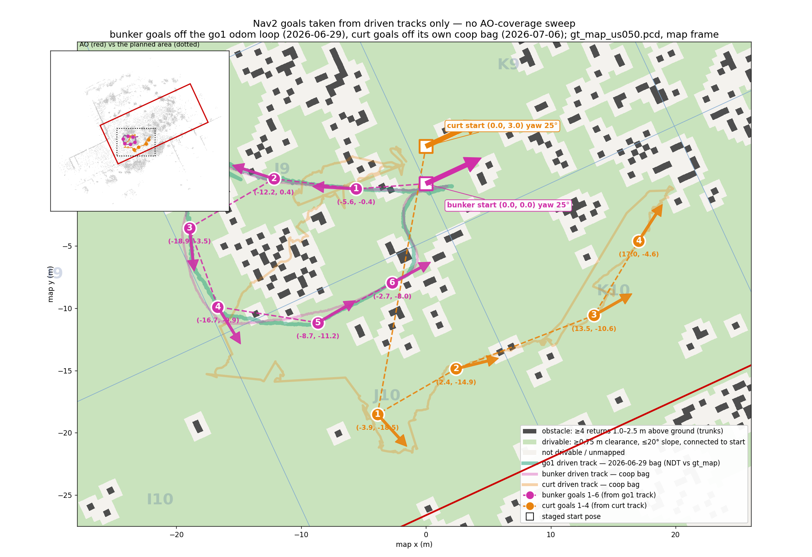

# Nav2 goal plan — goals taken from driven tracks only

Ten Nav2 goals, 6 for `bunker` and 4 for `curt`, each on ground a robot has
already driven. This is not an area-coverage plan: it does not sweep the I8–O10
AO, and ground with no driven evidence gets no goal (§4).

Positions are in the `map` frame of
[gt_map_us050.pcd](../../../hmr_localisation/gt_map/gt_map_us050.pcd), the frame
each robot's NDT localiser publishes in, so they can be sent as-is. AO geometry
and start poses follow
[experiment_script_forest_inspection.md](../../../../../doc/experiment_script_forest_inspection.md).



Magenta = `bunker`, orange = `curt`, teal = the `go1` track behind the `bunker`
goals. Numbered discs are goals (with coordinates and heading arrow), thick
translucent lines are driven tracks, green is drivable ground.

## 1. `bunker` — 6 goals, off the `go1` odom track

Start (0.00, 0.00), yaw 25°. West / +`v` loop, cells J9 → J10. Straight-line
path 42 m.

| # | x (m) | y (m) | yaw (°) | cell | ground z (m) | clearance (m) | off own track (m) |
| ---: | ---: | ---: | ---: | --- | ---: | ---: | ---: |
| 1 | -5.59 | -0.42 | 176.7 | J9 | 0.11 | 1.60 | 0.1 |
| 2 | -12.18 | 0.39 | 161.9 | J9 | 1.36 | 1.77 | 0.2 |
| 3 | -18.93 | -3.55 | -84.0 | J9 | 2.13 | 2.55 | 0.5 |
| 4 | -16.67 | -9.89 | -58.5 | J9 | 1.90 | 3.05 | 0.6 |
| 5 | -8.65 | -11.16 | 30.4 | J10 | 0.68 | 2.30 | 0.8 |
| 6 | -2.70 | -7.97 | 28.5 | J10 | -0.23 | 1.12 | 0.1 |

## 2. `curt` — 4 goals, off its own coop-bag track

Start (0.00, 3.00), yaw 25°. South-east / −`v` leg, cells J10 → K10.
Straight-line path 48 m.

| # | x (m) | y (m) | yaw (°) | cell | ground z (m) | clearance (m) | off own track (m) |
| ---: | ---: | ---: | ---: | --- | ---: | ---: | ---: |
| 1 | -3.88 | -18.51 | -47.7 | J10 | 0.23 | 3.25 | 0.0 |
| 2 | 2.42 | -14.86 | 14.0 | J10 | -0.68 | 3.75 | 0.0 |
| 3 | 13.47 | -10.57 | 29.8 | K10 | -2.46 | 4.67 | 0.0 |
| 4 | 17.04 | -4.59 | 57.1 | K10 | -2.99 | 4.16 | 0.0 |

## 3. How the goals were chosen

One goal every ~11 m of driven path, at least 6.5 m apart, each the pose with
the most obstacle clearance within ±3 m of arc. Yaw is the robot's own driven
heading there. The first ~15 m of each track is skipped, so no goal sits on a
start pose.

- `curt` candidates within 8 m of the `go1` corridor (`bunker`'s side) were
  rejected, so `curt`'s goals start 52 m into its track.
- Clearance is at least 1.12 m at every goal (§5). Every `bunker` goal is also
  within 0.9 m of `bunker`'s own track, so they do not rely on the `go1`'s
  smaller footprint.

### 3.1 The two robots share one patch — measured

The goals are separated. The robots are not.

| | |
| --- | --- |
| Closest goal of one robot to a goal of the other | 8.6 m (`bunker` 6 ↔ `curt` 2) |
| Goal lanes across the rows (`v`) | disjoint, 4.8 m gap (`bunker` −6.5…+5.5, `curt` −15.3…−11.3) |
| Convex hull of both goal sets | 409 m², one patch over cells J9/J10/K10, in an 8400 m² AO |
| Commanded straight-line routes | **cross, closest approach 0.0 m.** 16 % of `bunker`'s route is within 3 m of `curt`'s, 34 % within 6 m |
| `curt`'s 22 m transit from its start to goal 1 | passes **0.7 m from `bunker` goal 6** and crosses `bunker`'s route |

The evidence forces this: both bags leave the same deployment point, and 15 %
of `curt`'s driven poses are within 3 m of ground `bunker` also drove. No goals
in this bag set are both evidence-backed and far apart.

Handle it one of two ways, in order of preference:

1. **Launch `curt` first** and let it clear its transit south before `bunker`
   starts west. `bunker`'s goals 5–6 are its return leg, so the robots reach the
   crossing zone at opposite ends of their runs.
2. **Drop `bunker` goal 6** (0.7 m off `curt`'s transit, and the lowest
   clearance in the set at 1.12 m). `bunker` then ends at goal 5, 6.0 m from the
   transit line and 8.8 m from the nearest `curt` goal.

Either way, watch robot–robot separation live (panic threshold 1.5 m). The
planner's proximity stop makes `curt` cancel and hold when the pair is within
`proximity_hold_dist_m` (5 m). On hardware it needs `proximity_peer_pose_topics`
set to the peers' `pcl_pose`. It is coordination, not safety: the crewed panic
stop stays
([planner_method.md §10.3](../../docs/planner_method.md#103-coordinated-proximity-stop)).

## 4. Provenance of the `go1` track — and what it does *not* add

The `go1` bag (`2026_06_29_16_22_18__go1_kalhan_coop_2_`) has no odometry: its
`/tf` holds only leg joints. The track was recovered by replaying it through the
NDT stack against the same `gt_map`, with
[gt_ouster_ndt_tree_go1.yaml](../../../hmr_localisation/config/gt_ouster_ndt_tree_go1.yaml)
(initial pose x 2.75, y −0.50, yaw 106°) and
[ekf_odom_go1.yaml](../../../hmr_localisation/config/ekf_odom_go1.yaml) for
`odom → base_link`: 3929 poses over 214 s, 97 m of path (excluding 102 relock
jumps > 0.5 m).

The `go1` walked `bunker`'s corridor: distance from each `go1` pose to
`bunker`'s coop-bag track has median 0.16 m, 90th percentile 0.60 m, maximum
under 3 m. That cross-checks the NDT localisation, but adds no new ground. The
bag set has two driven sides:

| Side | Evidence | Extent (row frame) | Assigned to |
| --- | --- | --- | --- |
| West / +`v` loop | `go1` bag **and** `bunker` coop bag | `u` −20 … +2, `v` −6 … +9 | `bunker` |
| South-east / −`v` leg | `curt` coop bag only | `u` −22 … +18, `v` −19 … +5 | `curt` |

Not covered: SA-2, SA-3, all of row 8, and everything east of `u` ≈ 15 or north
of `v` ≈ +9, i.e. most of the AO. The goals span `u` ∈ [-19, 14],
`v` ∈ [-15, 6], about 8 % of the AO, with 409 m² of hull (§3.1). Going further
needs a survey pass first, or goals on unverified ground.

## 5. The drivability grid (background layer only)

The figure's green/grey layer and the clearance column come from a
bag-calibrated model, per 0.5 m column: obstacle = ≥ 4 returns 1.0–2.5 m above a
robust plane-fit ground model (DTM); clearance > 0.75 m by a 0.25 m distance
transform; slope > 20° impassable. It admits 88 % of `bunker`'s and 90 % of
`curt`'s driven poses. It only scores candidates; the tracks are the evidence.
A lower band (≥ 2 returns, 0.4–2.2 m) marked 98 % of `bunker`'s and 78 % of
`curt`'s track impassable: in this stand that band is mostly drive-through
understory.

## 6. Sending them

`z = 0`, orientation a pure yaw about map z. Publish to each robot's own
`/<robot>/goal_pose`, or feed the list to `FollowWaypoints`. `explo_planner`
publishes to the same topic, so only one of the two may drive a robot at a time.

```yaml
# frame_id: map, in execution order
goal_plan:
  bunker:            # from the go1 odom track
    poses:
      - { id: 1, x:   -5.59, y:   -0.42, z: 0.0, qz:  0.9996, qw: 0.0288 }   # J9  yaw  176.7°  ground z  0.11
      - { id: 2, x:  -12.18, y:    0.39, z: 0.0, qz:  0.9876, qw: 0.1573 }   # J9  yaw  161.9°  ground z  1.36
      - { id: 3, x:  -18.93, y:   -3.55, z: 0.0, qz: -0.6691, qw: 0.7431 }   # J9  yaw  -84.0°  ground z  2.13
      - { id: 4, x:  -16.67, y:   -9.89, z: 0.0, qz: -0.4886, qw: 0.8725 }   # J9  yaw  -58.5°  ground z  1.90
      - { id: 5, x:   -8.65, y:  -11.16, z: 0.0, qz:  0.2622, qw: 0.9650 }   # J10  yaw   30.4°  ground z  0.68
      - { id: 6, x:   -2.70, y:   -7.97, z: 0.0, qz:  0.2462, qw: 0.9692 }   # J10  yaw   28.5°  ground z -0.23
  curt:              # from the curt coop-bag track
    poses:
      - { id: 1, x:   -3.88, y:  -18.51, z: 0.0, qz: -0.4043, qw: 0.9146 }   # J10  yaw  -47.7°  ground z  0.23
      - { id: 2, x:    2.42, y:  -14.86, z: 0.0, qz:  0.1219, qw: 0.9925 }   # J10  yaw   14.0°  ground z -0.68
      - { id: 3, x:   13.47, y:  -10.57, z: 0.0, qz:  0.2571, qw: 0.9664 }   # K10  yaw   29.8°  ground z -2.46
      - { id: 4, x:   17.04, y:   -4.59, z: 0.0, qz:  0.4779, qw: 0.8784 }   # K10  yaw   57.1°  ground z -2.99
```

```bash
# bunker goal 1 by hand
ros2 topic pub --once /bunker/goal_pose geometry_msgs/msg/PoseStamped \
  '{header: {frame_id: map}, pose: {position: {x: -5.59, y: -0.42, z: 0.0},
   orientation: {z: 0.9996, w: 0.0288}}}'
```

## 7. Notes for the run

- **Launch `curt` first, then `bunker`** (§3.1). The robots stage 3 m apart,
  leave down the same corridor, and `curt` crosses 22 m of `bunker`'s patch to
  reach its leg. This is the plan's one real conflict.
- Ground falls along both routes (`bunker` +2.13 to −0.23 m, `curt` +0.23 to
  −2.99 m). That is well inside the AO's ~14 m relief, but the ROI z band must
  follow it.
- Total commanded path is ~90 m for the pair, a fraction of the 55-minute
  battery budget. To extend the run, do a fresh survey pass rather than add
  goals guessed from the point cloud.
